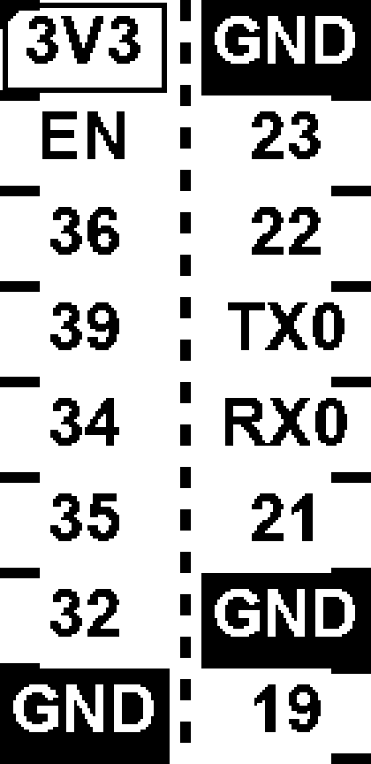
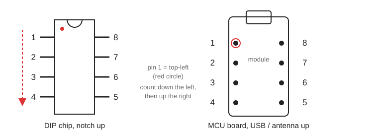
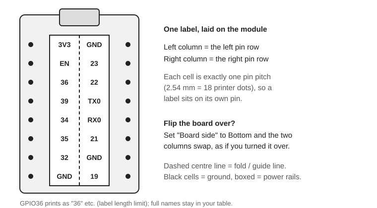
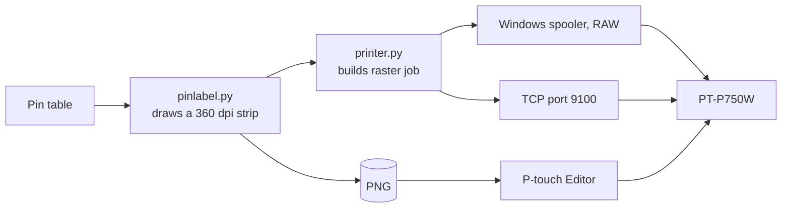
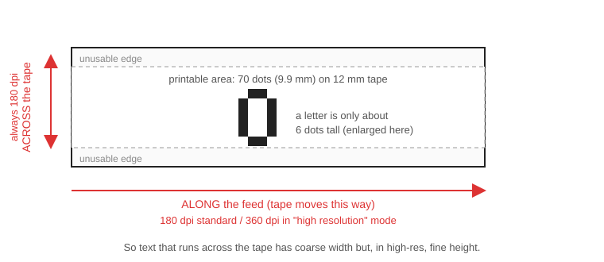

# Pin Label Maker

Make **pin-mapping labels for PCBs and dev boards** and print them on a Brother PT-P750W. One strip of tape lies between the two pin rows of a module, with each pin's name sitting right next to that pin, so you stop miscounting pins and stop losing track of which side is which when you flip the board over.

<p align="center">
  <br>
  <em>An 8 + 8 pin module. This is an upright preview; the exported file is the same strip lying on its side.</em>
</p>

It is a small [Streamlit](https://streamlit.io) app. You type in the pin names, it draws a strip at exact physical size (every cell is one pin pitch wide), and then you either **print it straight to the printer** or **export a PNG** for P-touch Editor.

- Two-row boards (MCU modules, DIP chips) on one strip, or a single row for a plain header
- Exact pitch: 2.54 mm, 2.00 mm, 1.27 mm, 1.00 mm or custom, down to the printer dot
- "Board side" switch that swaps the two columns, for when you turn the board over
- Ground pins print white-on-black, power rails get a box, pin 1 gets a corner mark
- Prints directly over USB (or the network) with no driver tricks, including half-cut
- Optional: pull pin names out of a pinout diagram (PNG, JPG or SVG)

---

## Quick start (Windows)

You need Windows, Python 3.12 or newer, and a PT-P750W with TZe tape.

```bat
git clone https://github.com/blueteef/Brother-Label-Pin-Header-Marking.git
cd Brother-Label-Pin-Header-Marking
py -3.12 -m venv .venv
.venv\Scripts\pip install -r requirements.txt
```

Then double-click **`PinLabelMaker.vbs`**. It starts the app in the background with no console window and opens it in your browser. For a desktop icon, make a shortcut to `PinLabelMaker.vbs`. To shut it down, run `StopPinLabelMaker.bat`. Launch it again while it's running and it just reopens the browser tab.

Want to see errors? Run `PinLabelMaker.bat` instead, which keeps a console window open.

Optional, for auto-filling labels from a pinout picture: `.venv\Scripts\pip install -r requirements-ocr.txt`

> The app only listens on `127.0.0.1`. It can print to your printer, so it is deliberately not reachable from the rest of your network.

## How to make a label

**1. Know how pins are numbered.** The tool always uses the same rule as a DIP chip: pin 1 is at the top-left, numbers run down the left side, then back up the right side to the top-right. MCU boards (ESP32, Pico, Seeed XIAO and so on) number the same way. Enter your pins in that order.



**2. Set up the label.** In the sidebar pick your tape width and pin pitch, choose *Two rows* or *One row*, and set *Pins on left side* (it defaults to half).

**3. Enter the pins.** Edit the table, or paste a list under *Paste labels*, or load a CSV. Names are free text. `GND`, `VSS`, `0V` print inverted, and `3V3`, `5V`, `VBAT` and similar print boxed. You can override that per pin in the `style` column.

**4. Check the preview.** It is turned upright so you read it like the real label. Pin 1 is at the top, the left pin row on the left.



**5. Flipped the board over?** Change *Board side* to *Bottom*. The two columns swap halves.

**6. Print it.** Under *Print directly* choose your printer, leave *Cut* on *Half cut* (see below), and press **Print label**. Or press **Download label PNG** and import it into P-touch Editor.

## The settings that matter

| Setting | What it does |
|---|---|
| **Tape width** | 3.5, 6, 9, 12, 18 or 24 mm. The tape in the printer must match. The printer can't tell the app if it doesn't. |
| **Pin pitch** | Width of one cell. 2.54 mm is exactly 18 printer dots, so labels line up with pins and never drift. |
| **Print quality** | *High 180x360* (default) or *Standard 180x180*. Use the same setting in P-touch Editor if you print from there. High is clearer because letters get twice the detail along the tape. |
| **Label length limit** | **Auto** picks how many characters fit at a readable size for the current tape and layout. **Custom** and **Off** are there too. Long names shrink the whole strip, so labels over the limit are shortened *on the label only* (`GPIO36` becomes `36`, `RESET` becomes `RST`). Your table keeps the full names, and the preview lists what changed. Type a short name in the table to override one. |
| **Text position** | Center, outside or inside each half. |
| **Length correction** | Stretches or shrinks the whole strip by a percentage, if your pins end up slightly off at the far end. |
| **Cut** | Half cut, full cut or none. |
| **More options** | Font, snapping, divider thickness, lines per cell (number / label / description), pin-1 mark, gutter and more. |

---

## Printing: how and why



**Direct printing** builds Brother's raster command stream itself and sends it through the Windows print spooler in RAW mode. That works over USB with the stock Brother driver, so there's no libusb or Zadig and the normal driver keeps working. The job is a normal print job named "Pin label". There's also a TCP option (port 9100) for Wi-Fi or LAN. **That network path is untested.**

**Why it prints better than the Editor route:** the app sends your 360 dpi columns as distinct raster lines and decides each printer dot itself. When you import a PNG, Editor resamples it to its own grid. In testing, the direct print of the same label was noticeably cleaner, and Editor's import also drifted about 0.5 mm over 20 pins (about 1%).

**Half cut** is the default. The printer cuts the label layer but leaves the backing paper attached, so a short label can't drop into the printer. About 25 mm of tape sits between the print head and the cutter, so every print begins with a blank leader.

### Using Editor instead
Download the PNG, insert it with *Insert > Picture > From file*, and check the object size matches the size shown in the app. Print the calibration PNG first and measure it with calipers. If Editor rescales it, type the right size into the size fields.

### Using it from Python
```python
import dataclasses
import pinlabel as pl
import printer as pr

# pins in DIP order: left column top->bottom, then right column bottom->top
names = ["3V3", "EN", "GPIO36", "GPIO39", "GPIO34", "GPIO35", "GPIO32", "GND",
         "GPIO19", "GND", "GPIO21", "RXD0", "TXD0", "GPIO22", "GPIO23", "GND"]
pins = [pl.Pin(str(i + 1), n) for i, n in enumerate(names)]
left, right = pins[:8], pins[8:][::-1]       # the right column runs bottom->top, so reverse it for the strip

opts = pl.Options(tape_mm=12, dual=True, lines=("label",), print_mode="high")
opts = dataclasses.replace(opts, max_chars=pl.auto_max_chars(opts))
img, info = pl.render_strip(left, opts, right)
pl.save_png(img, "label.png")                # horizontal strip at 360 dpi

pr.print_strip(img, 12, high_res=True, half_cut=True)   # prints to the Brother queue it finds
```

---

## Notes from building it

These are the things that were not obvious, in case they save you time.

**The printer's grid is coarse, and not square.** The head has 128 pins at 180 dpi across the tape. On 12 mm tape only **70 of them (9.9 mm)** are printable. Text that reads across the tape therefore has about 5 dots per character and about 6 dots of letter height. Along the feed you get 180 dpi in standard mode or 360 dpi in high-resolution mode.



**Why labels are limited to about 3 characters.** Auto-scaling sized the whole strip to the longest label, so one `GPIO36` shrank everything. Capping the length at 3 characters grew the text from 1.06 mm to 1.76 mm and fixed the readability problem on real tape. On 18 mm tape the auto limit rises to 5.

**Fonts.** We tried 14 installed Windows fonts at the real dot grid. The narrow bold ones (Franklin Gothic Medium Condensed, Arial Narrow Bold) fit larger text, but on a real print the two easiest to read were Arial Bold (no snapping) and Arial Narrow Bold (with snapping). Arial Bold is the default. No purpose-built bitmap font for this grid turned up.

**Snapping.** *Snap text to printer dots* pre-resamples the text to whole dots with a bias toward solid strokes. It makes the preview look blockier and is off by default. It's there if you want to compare.

**Thin lines vanish.** One 360 dpi pixel is half a printer dot. Dividers are 0.3 mm (4 px) by default for that reason, and cell edges all sit on whole-dot positions.

**Printable dots per tape width** (from Brother's raster command reference for the PT-E550W/P750W/P710BT, section "Print Area"): 3.5 mm = 24, 6 mm = 32, 9 mm = 50, 12 mm = 70, 18 mm = 112, 24 mm = 128. 3.5 mm tape reports itself to the printer as 4 mm.

**A Windows quirk.** On some setups `cmd` won't run a batch file by bare name from its own folder (the "don't search the current directory" policy). The launchers use full paths for that reason.

## What is and isn't tested

Tested end to end: **PT-P750W over USB on Windows 10, Python 3.12, 12 mm TZe tape**, high-resolution mode, half cut and full cut, and the calibration strip.

Not tested: other tape widths on a real printer (the dot counts come from Brother's documentation), standard 180x180 mode on paper, the TCP/Wi-Fi path, other PT-series models, and macOS or Linux. Direct printing is Windows-only because it uses the Windows print spooler. Everything else, including the PNG export, is plain Python and should run anywhere. The fonts are looked up in `C:\Windows\Fonts`.

The printer can't report back through this connection, so a mismatched tape width or an empty cartridge makes the printer error without the app knowing.

## Adapting it to another printer

The drawing code is mostly printer-independent. The printer-specific parts are a short list:

| Where | What to change |
|---|---|
| `pinlabel.py` `TAPE_DOTS`, `tape_height_px()` | Printable dots across each tape width, and the printer's across-tape dpi (currently 180). |
| `pinlabel.py` `OUT_DPI` | Resolution of the exported PNG. 360 is two pixels per 180 dpi dot; pick a clean multiple of your printer's resolutions. |
| `pinlabel.py` `_snap()` and `printer.py` `_to_dots()` | The 2:1 divisors that map 360 dpi pixels to dots. Change them if your dot pitch differs. |
| `printer.py` `PIN_CONFIG`, `TAPE_WIDTH_CODE`, `TOTAL_PINS`, `BYTES_PER_LINE` | Pin layout: unused left pins, printable pins, unused right pins per tape, and the head size. |
| `printer.py` `build_job()` | The command bytes (`ESC i z`, `ESC i M`, `ESC i K` and so on) and the raster-line encoding. |
| `printer.py` `MIN_MARGIN_MM`, `INK_COVERAGE` | Minimum feed margin and how much ink in a dot makes it print. |

Notes for specific families:

- **Same-family P-touch models** (PT-E550W, PT-P710BT) share the PT-P750W's pin layout in Brother's spec and should need little or no change, but they are untested here. The P710BT is Bluetooth, so you'd need a different transport.
- **PT-P900 series** has 560 pins at 360 dpi. It needs different pin tables, a longer raster line (70 bytes), and the dpi constants above. The [`ptouch`](https://github.com/nbuchwitz/ptouch) Python library has those tables.
- **QL series and other brands** use different protocols, so the print path doesn't apply. The **PNG export still does**: set the image's physical size in your label software.

The pin tables are currently in two places (`TAPE_DOTS` and `PIN_CONFIG`). If you add a printer, a small printer-profile class that holds both would be a good first refactor.

## Auto-fill from a pinout diagram (experimental)

Open *Auto-fill labels from a pinout image*, upload a board diagram, and pick which label column to read. Diagrams usually stack several columns beside each pin (port name, alias, function), and column 1 is the one nearest the board. PNG/JPG files are read with [RapidOCR](https://github.com/RapidAI/RapidOCR); SVG files are read from their text elements directly. Results are shown with green boxes on the image so you can check them before pressing *Use these labels*.

It worked cleanly on two nRF52840 board diagrams (XIAO and a Pro Micro clone), apart from OCR mixing up `0` and `O` in a few names, which the code corrects for common patterns. It ignores legends, board text and vertical pad labels, but unusual layouts will need manual fixing.

## Files

| File | Purpose |
|---|---|
| `app.py` | The Streamlit interface |
| `pinlabel.py` | Draws the strip: geometry, fonts, label shortening, calibration strip |
| `printer.py` | Builds Brother raster jobs; sends via the Windows spooler or TCP; includes a decoder used for verification |
| `extract.py` | Pinout image / SVG label extraction |
| `PinLabelMaker.vbs` / `.bat` / `StopPinLabelMaker.bat` | Background launcher, visible launcher, stop script |

## Troubleshooting

- **Nothing printed.** Check the tape width matches, the printer is on and showing in Windows, and the cartridge isn't empty. The job leaves the queue even if the printer rejected it.
- **Text is hard to read.** Shorten labels (lower the length limit), use wider tape, and keep *Print quality* on High.
- **Pins don't line up at the far end.** Print the calibration strip, measure it, and use *Length correction*.
- **The browser opens but the page won't load.** Run `PinLabelMaker.bat` to see the error. The usual cause is that the requirements aren't installed.
- **Logs** from the background launcher go to `%TEMP%\pin_label_maker.log`.

## Credits and license

MIT licensed, see [LICENSE](LICENSE).

The print stream follows Brother's *Raster Command Reference for the PT-E550W/P750W/P710BT* and was cross-checked against the open-source [`ptouch`](https://github.com/nbuchwitz/ptouch) library (LGPL), whose pin tables cite the same document. No code from it is included. [RapidOCR](https://github.com/RapidAI/RapidOCR) is used optionally for image import.

This project is not affiliated with Brother Industries. "P-touch" and "TZe" are Brother trademarks.
